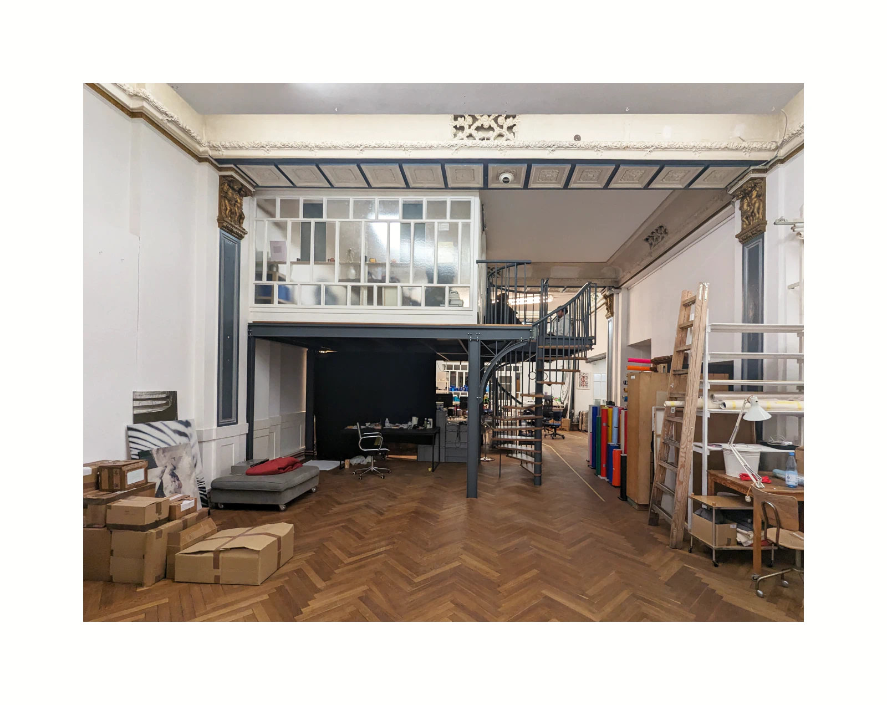
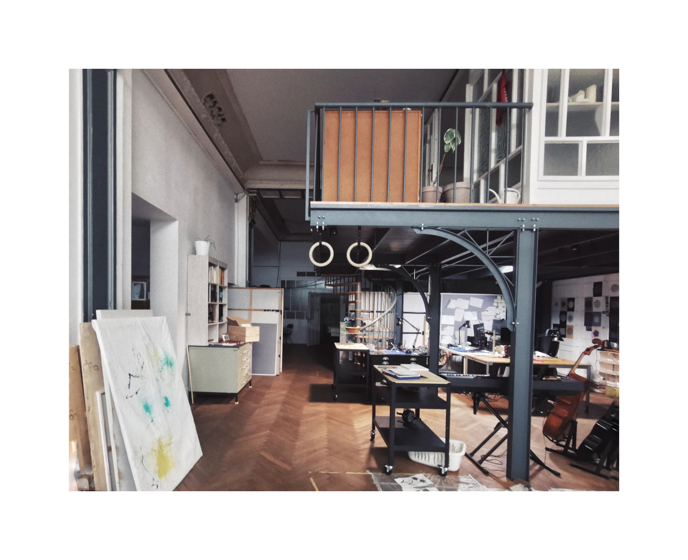
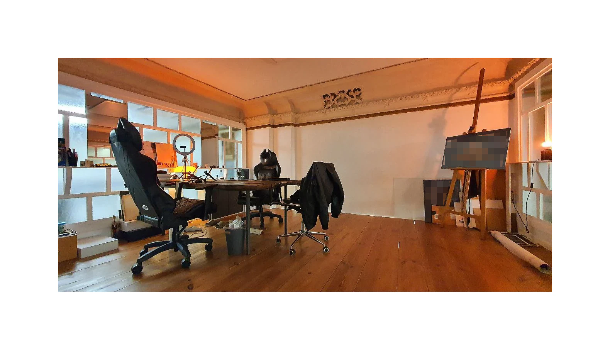

+++
title = 'Studio open call'

[extra]
archive = true
frontpage = true
subtitle = 'Shared studio available for rent now'
description = 'Join Prachtsaal Studio, a creative studio in Neukölln, Berlin'
date = 2026-11-26
endDate = 2026-12-31
tags = ['opencall', 'studio']
+++

We’re looking for new people to join us at Prachtsaal Studio, our beautiful open space in Neukölln (halfway between U-Leinestraße and U-Hermannstraße)!

Prachtsaal is a non-profit with about 20 resident artists in all kinds of fields. The studio is ~342m² and is divided in 10 ateliers. Once in a while we run events, but otherwise it's quiet.

There's a garden, a shed with tools, we can laser cut, 3D-print, print large
format images, there are projectors, speakers, and more.

The studio is on the street level and the bathrooms downstairs.

The available space is located in a mezzanine inside Prachtsaal Studio, accessible via a spiral staircase.

Shared studio with Marta. Here you can see the metal staircase.

The Mezzanine has a small balcony.

On the top left you can see the North side of the mezzanine, all tinted glass.

Another view of the inside.

