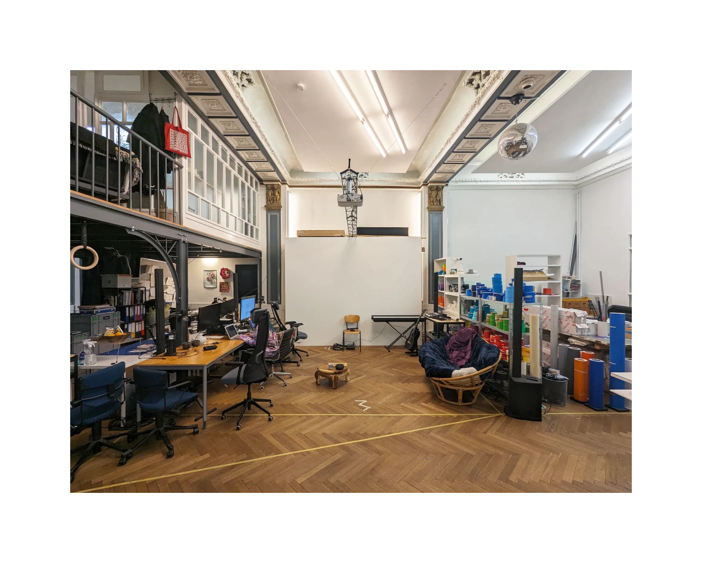

+++
title = 'Studio open call'

[extra]
archive = true
frontpage = true
subtitle = 'Shared studio available for rent now'
description = 'Join Prachtsaal Studio, a creative studio in Neukölln, Berlin'
date = 2026-11-26
endDate = 2026-12-31
tags = ['opencall', 'studio']
+++

We’re looking for new people to join us at Prachtsaal Studio, our beautiful open space in Neukölln (halfway between U-Leinestraße and U-Hermannstraße)!

Prachtsaal is a non-profit with about 20 resident artists in various fields. The studio is ~342m² and is divided in 10 ateliers. Once in a while we run [events](/events/2024-05-21-audiovisualjam-abe-grit-gabor/), but otherwise it's quiet.

We have a nice [garden](/events/2025-09-04-lanterns-unseen/PRACHTSAAL_250904_-087.webp), a small kitchen, a shed with tools, a laser cutter, a 3D-printer, large
format printers, projectors, speakers, and many nice people :-)

The studio is at the street level, the bathrooms are downstairs. The available space for rent is located in a mezzanine inside Prachtsaal Studio, accessible via a spiral staircase.

The 17.6m² studio and the 4.4m² balcony are shared with [Marta](/members/marta-muschietti/). Each one pays ~270€ rent per month.

On the top left you can see the North side of the mezzanine, a wall of tinted glass.

Another view of the inside.

If you are interested, please get in touch via [e-mail](https://prachtsaal.berlin/impressum/) or Instagram and arrange a visit <3
